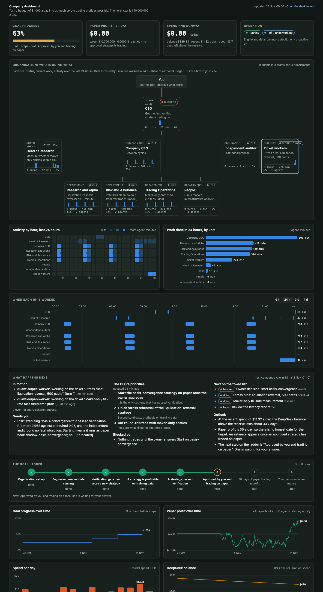
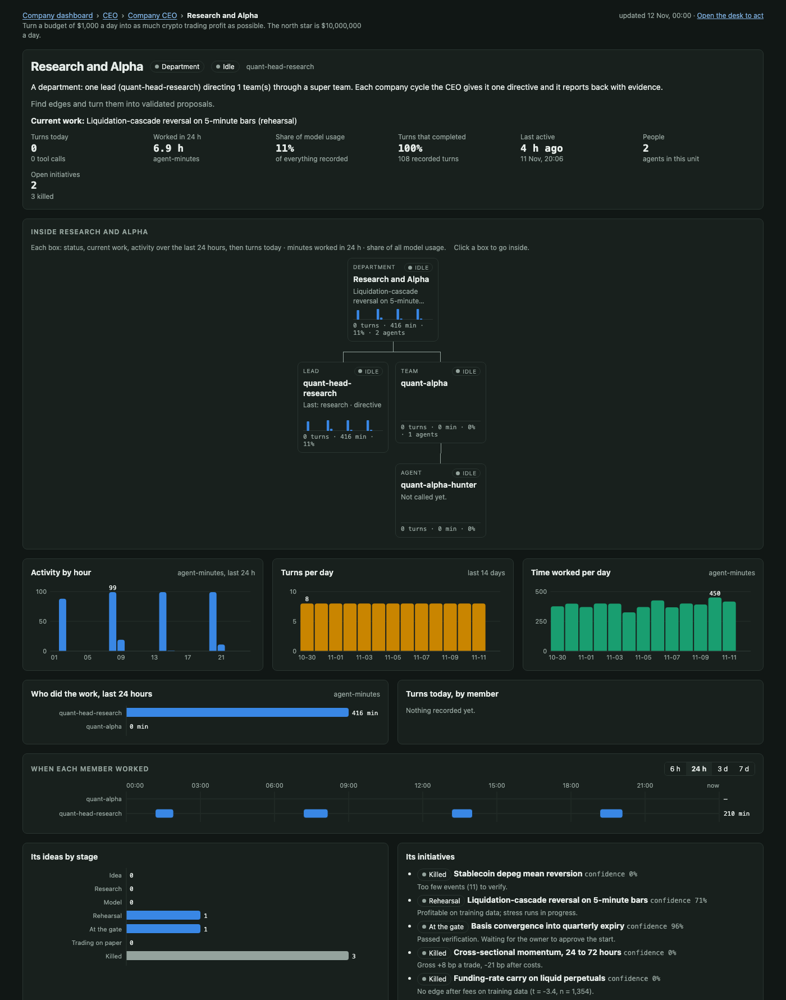
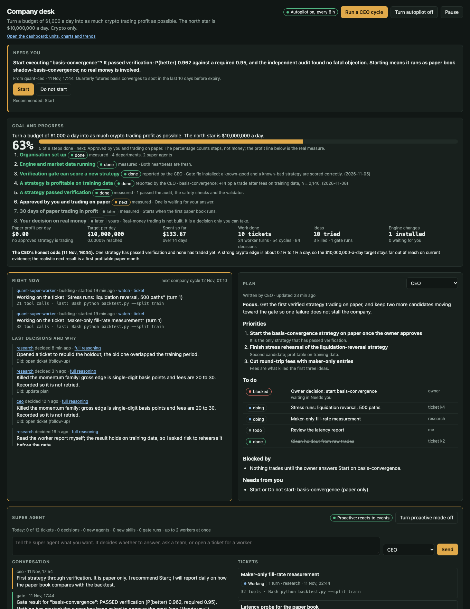

# DeepSeek Harness + Agent Forge (on your Claude subscription)

This folder contains a local install of [DeepSeek Harness](https://github.com/deepseek-ai/deepseek-harness)
(`dsh` 0.2.1-rc.5) and two local plugins:

| Plugin | What it does |
|---|---|
| `plugins/claude-code-bridge` | Serves every harness model call through **genuine Claude Code sessions** on your local Claude Code login (your subscription). It adds the `claude-code` provider (opus / sonnet / haiku) and makes it the default model. |
| `plugins/agent-forge` | **Configurable agents, teams, orchestrations and multi-agent chat**, with `forge_*` tools for the harness lead agent, a standalone console and a CLI. |
| `plugins/agent-forge-web` | Puts Agent Forge **inside the DSH web UI**: four sidebar pages (Agent chat, Agents, Agent teams, Workflows) served from `/forge/` on the DSH web server, behind the DSH login. |
| `plugins/project-board` | A **Projects** page: projects with categorized tasks; each task runs its own orchestration of agents and workflows. |
| `plugins/cli-workbench` | A **CLI workbench** page in the web UI: many interactive Claude Code, Codex and OpenCode terminals side by side, each in its own git worktree. |
| `plugins/super-team` | A **Super team** page: one supervisor agent orchestrates many agent teams, in parallel or in sequence depending on the task, with every Agent chat mode at both levels. |
| `plugins/company` | A **CEO agent** that owns one written goal and a daily budget, directs department leads (each a super team of agent teams), hires through an HR team, and executes only through a deterministic gate. Run **many companies** on one computer: each has its own forge home, CEO, agents, teams, super agents, memory and budget, and runs in its own process ([docs/COMPANIES.md](docs/COMPANIES.md)). |
| `plugins/company-dashboard` | Two pages. **Company** (the desk, where you act): decisions waiting for you, goal progress, what is happening now, each super agent's plan, tickets, the initiative pipeline, engine controls, the organisation, a timeline and the charter. **Dashboard** (read-only): every business unit and what it is working on, an activity chart, what happens next, trends and daily operating numbers. |
| `plugins/super-agent` | An always-on **super agent** (after DeepSeek's dsh-superagent prototype): it reacts to events, opens tickets worked by sandboxed workers with a shell, talks to agents, teams and super teams, and builds its own organisation. Super agents form a tree under one CEO. |
| `plugins/group-hq` | A **group headquarters** (not loaded in the web profile by default): companies on this or other computers join it from their own **Connections** page with an invite code; it shows everything each company shares, sends directives and policies within the authority each company's owner gives it (observe, advise, direct), and has a group CEO and an independent review team. See [docs/GROUP.md](docs/GROUP.md). |

### What it looks like

Both screenshots show **invented sample data**, not a real account.

The **Dashboard** page: goal progress, every business unit and what it is working on, when each unit worked, what
happens next, trends and daily operating numbers.



Click any box in the org chart to go inside a department, a team or one agent, each with its own numbers and charts.



The **Company** page (the desk): what needs your answer, the goal ladder, what is running now and the last decisions
with their reasons, and the CEO super agent's plan.



DSH's own **Agent Teams** bundle is also enabled in the `web` profile (`spawn_teammate`, a shared task board, and a team UI).

## Start

```bash
./dsh web                 # Web UI → prints http://127.0.0.1:3080/?token=...
                          #   also starts the bridge (127.0.0.1:3099) and the Agent Forge console (127.0.0.1:3091)
./dsh headless "task"     # one-shot task in the terminal
./forge-cli serve         # Agent Forge console without the harness
```

In the Web UI sidebar you get four Agent Forge pages:

| Page | What you do there |
|---|---|
| **Agent chat** | Group chat with any agents you pick (or a whole team). Reply modes: `sequential` (each agent replies in turn and sees earlier replies), `parallel` (all at once), `mention` (only `@name`d agents reply). An agent that writes `@other-agent` hands the floor to it, up to the room's hand-off limit. **Channels** run several tasks of the same team in parallel: each channel has some or all of the chat's agents, reads the main chat as context, can work in its own git worktree, and posts each finished task's result back to Main. **Side chats** (the pop-out button on an agent) are private one-to-one windows that never post to the group chat. **Ask another team** (or an agent's `ask_team` tool) opens a channel in another team chat and brings the answer back; an agent's `open_team_chat` starts a new team chat only after you approve it. |
| **Agents** | Create, edit, clone, delete and test-run agents (model, effort, memory, skills, sub-agents, permission, host/sandbox/container/VM). Skills tab: install from GitHub or a folder. |
| **Agent teams** | Group agents into teams, start a chat with a team, or start a new workflow from a team. |
| **Workflows** | Visual stage builder (single or parallel agents per stage) or code orchestrations; run them and watch live progress, per-agent transcripts and results on the Runs tab. |

The same console also runs standalone at `http://127.0.0.1:3091/?token=$(cat forge/.cache/console-token)` (or `./forge-cli serve`).
DSH's own **Agent Teams** feature (`spawn_teammate`) shows up as a team button in a chat's header once the lead agent has spawned teammates; ask it to, for example, *"Spawn a reviewer teammate and a tester teammate for this task"*.

All state stays in this folder: `.dsh-home/` holds harness profiles and sessions, and `forge/` holds agents, memory and runs.
Node 24 is installed in `~/.local/node`, and the launchers add it to `PATH` automatically.

## Agent Forge concepts

```
forge/
  agents/<name>.yaml           one file per agent (edit by hand, in the console, or via the lead agent)
  teams/<name>.yaml            named groups of agents
  orchestrations/<name>.js     code orchestrations (loops, branching, structured output)
  orchestrations/<name>.yaml   declarative stage pipelines (what the console's visual builder makes)
  skills/<name>/SKILL.md       skill library; agents select skills by name
  memory/                      per-agent / per-team / global memory
  runs/<id>/                   run.json, per-agent transcripts, artifacts/
  reports/news, reports/security
```

### Agent configuration

```yaml
name: vuln-hunter
description: Audits a source tree for vulnerabilities
role: |                       # appended to the Claude Code system prompt
  ...
backend: claude-code          # claude-code (default, Agent SDK) | claude-cli | codex | opencode (your local CLI) | dsh (dsh headless, e.g. a DeepSeek model)
model: opus                   # opus | sonnet | haiku | full model id
effort: high                  # low | medium | high | xhigh | max
permission: allow             # allow (default) | acceptEdits | auto | plan | deny
tools: default                # all Claude Code tools, or a list: [Read, Grep, Glob, Bash, WebSearch, WebFetch]
skills: [vuln-hunting]        # only these skills are visible (builtinSkills: true to also allow Claude Code's bundled skills)
subagents: [coder]            # other forge agents exposed as native Claude Code Task sub-agents
memory:
  mode: markdown              # none (stateless) | markdown | journal | hybrid | session
  scope: team                 # agent | team | global
  namespace: vuln-patterns    # optional shared memory namespace
execution:
  mode: sandbox               # host | sandbox | container | vm
  allowedDomains: [example.org]   # sandbox network allowlist additions
  # container: image: agent-forge-claude:latest   (build: docker build -t agent-forge-claude plugins/agent-forge/container)
  # vm:        command: [ssh, -T, devbox]          (or [limactl, shell, default])
maxTurns: 80
mcpServers: {}                # passed through to Claude Code
disallowedTools: [WebSearch, mcp__github__delete_repository]   # always blocked
mcp: [github, playwright]     # servers from the shared MCP library (forge/mcp/<name>.yaml)
externalMcp: false            # true = also load .mcp.json, your Claude Code MCP config and claude.ai connectors
fallbackModel: sonnet
maxBudgetUsd: 5
settingSources: [project]     # project | local | user Claude Code settings to load
env: { MY_FLAG: "1" }
project: ~/code/my-app        # default working folder (relative paths are relative to forge/)
folders: [~/Documents/specs]  # extra folders the agent may read and write
```

**MCP servers** live in a shared library (Agents page, MCP servers tab, with templates for filesystem, GitHub, Playwright, memory, sequential thinking and Context7, plus a connection test). Each agent ticks the servers it should get; by default an agent sees only those, not your personal Claude Code MCP servers or claude.ai connectors. Put secrets in as `${VAR}` references to the harness environment; literal values are stored in `forge/mcp/` (mode 600) and shown masked in the browser.

Every agent also has its own folder, `forge/agent-homes/<name>/`. Its `files/` subfolder is the agent's content library: reference docs, briefs, examples or data you give it, plus work products it saves. The files are listed in the agent's instructions on every run, and you can browse, upload, edit and delete them on the Agents page under **Folders and files**. Working folder order: the folder a run or chat passes, then `project`, then the agent's own folder. Cloning an agent copies its content library. Sandbox and container modes grant access to all of these folders.

Memory modes:
- `none`: stateless.
- `markdown`: curated notes the agent writes with `memory_save`, `memory_search` and `memory_read`. An index is injected at the start of each run.
- `journal`: every run's task and outcome is appended automatically, and the last entries are injected.
- `hybrid`: markdown and journal together.
- `session`: resumes the agent's previous Claude Code conversation.

Execution modes:
- `host`: runs normally on your Mac.
- `sandbox`: Claude Code's native macOS sandbox. Writes are limited to the working directory and tmp, network is limited to an allowlist, and `~/.ssh` and `~/.aws` are unreadable.
- `container` / `vm`: run Claude Code remotely through Docker or an SSH/Lima prefix. Both need `claude` installed on the remote side and `CLAUDE_CODE_OAUTH_TOKEN` (from `claude setup-token`) exported. **These two modes are implemented but untested here, because Docker is not installed.**

Clone an agent:
- **Console:** use **Clone** on the Agents tab.
- **Lead agent:** ask for it in chat; it uses the `forge_agent_clone` tool.
- **CLI:** `./forge-cli agent clone code-reviewer perf-reviewer model=sonnet memory.mode=none 'role=Review for performance only'`

Install skills:
- **Console:** Skills tab → Install.
- **CLI:** `./forge-cli skill install github:anthropics/skills/skills/webapp-testing`, or a GitHub tree URL, or a local folder.
- Then add the skill to the agent's `skills:` list.

## Local CLI agents: Claude Code, Codex and OpenCode

Any agent can run through a coding CLI installed on your machine, using that CLI's own login:

| backend | Runs | Log in once with |
|---|---|---|
| `claude-cli` | `claude -p --output-format stream-json` | `claude` (then `/login`) |
| `codex` | `codex exec --json` | `codex login` |
| `opencode` | `opencode run --format json` | `opencode auth login` |

Install them with `npm i -g @anthropic-ai/claude-code @openai/codex opencode-ai`.
Ready-made agents named `claude-cli`, `codex` and `opencode` are in `forge/agents/`.

**Running many at once.** Every reply spawns its own CLI process, so you can:
- open several chats in **Agent chat** and send to all of them without waiting;
- put several CLI agents (or the same one several times) in a room set to `parallel`;
- use CLI agents as parallel stages in a workflow (`FORGE_MAX_PARALLEL`, default 4, caps workflow concurrency).

How agent settings map to each CLI:
- **model**: `opus`/`sonnet`/`haiku` go to Claude. For Codex and OpenCode, use `default` (the CLI's own choice) or an id such as `gpt-5.5` or `provider/model`.
- **effort**: `--effort`, Codex `model_reasoning_effort`, or OpenCode `--variant`.
- **permission**: `allow` skips approvals. `plan`/`deny` run read-only (Codex `-s read-only`, OpenCode plan agent). Codex with `execution.mode: sandbox` uses `-s workspace-write`.
- **memory.mode: session** resumes the CLI's own session.
- **Other settings**: role, memory context and the folder list go into the system prompt. Claude also gets `--add-dir`, MCP servers and tool lists. Forge memory tools (`memory_save` and similar) and skills only apply to the `claude-code` backend.
- **Custom binary**: set `cliPath` on an agent, or `FORGE_CLAUDE_BIN` / `FORGE_CODEX_BIN` / `FORGE_OPENCODE_BIN`.

## Projects: tasks with their own orchestration

The **Projects** sidebar page organizes work as projects, each with many tasks on a board (Backlog, To do, In progress, Review, Done; drag cards between columns).

- **Project:** a name, a folder (usually a git repo) and a description that every agent gets as context. Each project has its own **categories** (it starts with Feature, Bug, Research, Docs and Chore; rename, recolor, add or remove them under Project settings). Filter the board by category, or search it.
- **Task:** a title, a description, a category, a status, an optional folder, and its own **orchestration**: a list of steps that run top to bottom.
  - **Agent step:** one agent, or several agents (or a whole team) that run in parallel.
  - **Workflow step:** any saved workflow from the Workflows page, with its inputs filled from the task.
  - Every step sees the task and the results of the steps before it. In instructions and workflow inputs you can use `{{task.text}}`, `{{folder}}`, `{{previous}}` (all earlier results) and `{{last}}` (the step before).
  - A step fails the run if all its agents fail, unless **Keep going if this step fails** is ticked.
- **Category templates:** a category can hold a template orchestration. New tasks in that category start with it, and **Save as category template** stores a task's steps as the new template. New projects come with starter templates for Feature (planner, then implementer, then code and security review in parallel) and Bug (implementer, then QA), using whichever of those agents you have.
- **Running:** **Save and run** starts the orchestration as an Agent Forge run. The task moves to In progress, then to Review when the run completes. The panel shows live progress per agent, each agent's transcript, the result and the run history. Runs also appear on the Workflows page under Runs, and each step's result is saved in the run's `artifacts/` folder.
- **Own git worktree:** tick it on a task to run it in its own worktree on branch `task/<id>` (under `forge/worktrees/`), so parallel tasks never touch each other's files.
- **Open in CLI workbench:** starts an interactive Claude Code session for the task on the CLI workbench page.

Every agent keeps its own settings (model, backend such as `claude-cli` or `codex`, skills, memory, execution mode). Projects are saved in `forge/projects/` (excluded from git).

## Super team: one supervisor, many agent teams

The **Super team** sidebar page is a chat with a *super team*: one supervisor agent (default `super-orchestrator`, Opus) that runs whole Agent Forge teams as its workers.

**Super-team modes** (how the supervisor runs its teams):

| Mode | What happens |
|---|---|
| `auto` (default) | The supervisor plans **waves**: teams in one wave run **in parallel**, waves run **in sequence**, and later waves see earlier results. After each round it reviews the results and can add follow-up waves (up to *Max rounds*). |
| `sequential` | Every team works in turn (in the listed order) and sees the earlier teams' results. |
| `parallel` | Every team works on the request at the same time. |
| `mention` | Only teams you `@mention` (e.g. `@dev-team`) work, in that order. |
| `handoff` | The supervisor delegates one round at a time, reads the results, then picks the next team(s) or finishes. |
| `workflow` | Each message runs a saved workflow with your args plus `message` and `teams`. |

In `sequential`, `parallel` and `mention` mode, a team whose result `@mentions` another team hands the work on to it (up to *Max team hand-offs*). Unless you untick it, the supervisor writes one final answer from all the team results.

**Team modes:** inside the super team, each team keeps the Agent chat modes: `sequential`, `parallel`, `mention`, `handoff` (with a lead) and `workflow`, plus `@agent` hand-offs between members. Per team you can also choose which members take part and give the team a role. Supervisor briefs can `@mention` individual members.

**Team chats:** every team in a super team has its own chat on the **Agent chat** page (titled `<super team> · <team>`, in the Agent chat project with the same name as the super team's project). It is created the first time the team gets work, or you pick an existing chat for that team in Settings → Team chat. Two ways to use it:
- **Linked** (default): the supervisor's brief is posted into the team's chat and the chat's agents reply there. The chat's own mode, lead, hand-offs, folder, project agent settings and history apply, so the team remembers its earlier work, and you can keep talking to the team directly in between. If you are chatting with the team when the supervisor needs it, the supervisor waits (up to 15 minutes). The replies still count in the super team's run (cost, transcripts), and Stop stops them.
- **Copy:** the team works as a fresh discussion configured in the super team, and the brief and replies are copied into its chat for reading. Teams in workflow mode always work this way.

Messages from a super team show as **Supervisor** with a `super team: …` tag in Agent chat. The step cards in the super team link to the team's chat. A duplicated super team gets new chats.

**Projects (tabs):** the tab bar at the top groups super teams by project, so one project can hold many super teams, each with its own supervisor, mode and teams. **+ Project** creates one, with a name, a color, an optional default folder (new super teams in it start there) and a description that every supervisor and team in it gets as context. The ✎ on the active tab edits or deletes the project; deleting moves its super teams to **General** or deletes them. **All** shows every super team, labelled by project. Settings → Project moves a super team to another project.

Each message is one Agent Forge run, so it also shows on Workflows → Runs. Click any agent in the timeline to open its transcript. Follow-up messages see the earlier requests and answers. `FORGE_MAX_PARALLEL` (default 4) caps how many agents run at once across all teams. Chats are saved in `forge/super-teams/` and projects in `forge/super-team-projects.json` (both excluded from git).

## Super agent: an always-on CEO that reacts, builds and organises

`plugins/super-agent` follows the design of DeepSeek's [dsh-superagent prototype](https://github.com/deepseek-ai/dsh-superagent-prototype) (Source, Trigger, Eval, Ticket, Executor, Channel), pointed at the company charter instead of a GitHub repository. It appears at the top of the **Company** page and in `./super-cli`.

```
sources ──> trigger ──> super agent decides (tools only) ──┬─> ticket ─> worker in its own sandboxed folder ─> report
 your messages                                             ├─> ask an agent (answer now), a team or a super team (reply later)
 company: build requests, finished CEO cycles              ├─> delegate to a super agent below it
 engine: health changes                                    ├─> create or improve agents, teams, super teams, super agents; install skills
 clock: one daily review                                   └─> write to you (a result, or one question)
 replies from agents, teams, super teams, workers, the gate
```

- **It acts on events, not on a timer.** Your messages are always handled. Proactive mode (off until you turn it on) adds the company, engine and clock sources.
- **Tickets are real work.** Each ticket gets a folder under `forge/super-agent/work/` and a worker with a shell. The worker reports `ready`, `progress`, `waiting`, `blocked`, `failed` or `dropped`; a question waits for you under **Needs you**; your answer resumes the ticket.
- **Super agents form a tree.** The root (the CEO) reaches every super team, team and agent. It can create super agents below it, each leading the super teams, teams and agents it is given, and each able to create more within the same limits.
- **It builds its organisation inside fixed templates.** A new agent is an analyst (read-only) or a builder (sandboxed shell); the super agent chooses the name, role text, DeepSeek model and skills, never the tools or permissions. Changed agents are backed up first.
- **Skills from the internet are audited.** `install_skill` downloads one `SKILL.md` from GitHub; the independent auditor (a different model) reads it, and it is installed as `quant-ext-<name>` only when judged safe.

**Limits enforced in code**

- A worker's shell runs in the OS sandbox: it writes only inside its ticket folder, cannot read the key files or the other bot's config, and reaches only public market-data hosts and the package registries. File edits outside the folder are refused.
- A worker's config proposal goes through the same gate as the company's: audit, safety invariants, validator. Nothing else reaches a paper book, and nothing places a real order.
- New work stops when the day's budget is spent or the DeepSeek balance is at the reserve. Tickets, decisions, new agents, new skills and gate runs each have a daily limit.
- One process runs the loop (`forge/super-agent/loop.lock`); other processes queue their commands for it.

```bash
./super-cli setup                 # create the CEO super agent and the worker (safe to repeat)
./super-cli say "what you want"   # write to the CEO super agent
./super-cli status                # super agents, tickets, what waits for you
./super-cli answer <ticket> "..." # answer a worker's question
./super-cli on | off              # proactive mode
./super-cli run                   # run the loop here when neither ./dsh web nor ./company-cli serve is running
```

State is in `forge/super-agent/` (excluded from git).


### Seeing what it does, and letting its work reach the engine

The Company page shows, top to bottom: **Goal and progress** (a ladder of eight steps measured by code where code can
measure them, paper profit per day against the target, and the effort spent), **Right now** (who is working on what,
and the last decisions with their reasons), the **Plan** each super agent must keep current (focus, priorities, to-do
list, blockers, what it needs from you), the **Organisation** (click anyone for its role, who it reports to, what it
is doing, its recent work and cost) and one **Timeline** you can filter by individual or look back in.

- **Engine runner.** `./super-cli engine on` (or the button on the page) starts the dry-run chain bot, the collector
  and the paper daemon and restarts them when they stop. It refuses to start the chain bot unless its config is dry-run.
- **Engine changes.** A worker cannot touch the engine. It delivers a patch; the super agent submits it; code checks
  that it only touches `quantcore/`, `config/` and `tests/` and loosens no loss limit; the independent auditor reads
  it; you answer Install or Do not install; then it is tested on a copy, applied with a backup and rolled back when the
  engine's tests fail.
- `./super-cli plan` prints the goal ladder, every plan and what is running now.

## Company profiles: any industry, and a leader that decides

The company and the super agent are not tied to one industry. What a company is (its organisation, charter, rules,
pipeline stages, skills, models, facts and gate) lives in a **profile** under `plugins/company/profiles/`:

| Profile | What it is |
|---|---|
| `generic` | A starting point for any company that produces files. Its gate: static checks, an independent rebuild and test in the sandbox, and an audit with a quality score. |
| `vr-studio` | A VR game studio that ships WebXR games into `../vr-studio/release-candidates/`. Runs on the Claude subscription. |
| `quant` | The original crypto trading company described below. Needs the private `quant/` engine and a DeepSeek key. |

```bash
./company-cli profile                 # the active profile and the available ones
./company-cli profile vr-studio       # select one, then restart and run the two setups
./company-cli setup && ./super-cli setup
./company-cli setup --refresh-agents  # after editing a profile: rewrite its agents, keep teams and hires
```

Write your own by copying `vr-studio.js`; `makeProfile` in `generic.js` documents every field.

**The owner is asked very little.** The company decides everything inside its charter. Only owner-only matters
(spending, anything public, legal, access, the charter) can reach "Needs you", one at a time, and the host
enforces that in code. What the company decided is listed under "Decided for you" with an Overrule button. The
charter's `autonomy` setting switches back to "ask me everything".

**The super agent leads at master level.** It carries three leadership skills (`executive-judgment`,
`masterwork-standard`, `grand-scale-orchestration`), runs on the strongest model at the highest effort, sends work
to a critique panel before the gate (`critique`), and lays out large work as a programme: tickets in workstreams
that wait for each other (`dependsOn`), with principal builders on the hardest ones.

The design is in [docs/SUPER-AGENT-AUTONOMY.md](docs/SUPER-AGENT-AUTONOMY.md).

Every leader (the CEO, the super agents below it, the COO and the department heads) keeps a plan with dependencies,
works several threads at once, and starts planned work by itself as soon as it is unblocked. By default the company
runs continuously instead of in batch cycles. See [docs/LEADERS.md](docs/LEADERS.md).

Work is checked before it counts as done, every review says who fell short and why, agents search for know-how
(skills and best methods) when work is new or stuck, giving up needs three distinct approaches and a rescue
challenge, and lessons become playbooks and new skills that are kept only when they help. See
[docs/GROWTH.md](docs/GROWTH.md).

## Company: a CEO over departments, with a budget and a gate

The **Company** sidebar page (and `./company-cli`) runs a small company of agents toward one goal.

```
you (owner)  ->  CEO  ->  department leads  ->  agent teams  ->  agents
                  |         (each department is a super team; the lead is its supervisor)
                  +-> HR team (hires new read-only agents)      +-> independent auditor (a different model)
```

**A cycle** (`Run a CEO cycle`, `./company-cli cycle`, or autopilot every N hours):

1. **Facts.** Code measures the engine: health, paper books, simulation safety invariants, validator state, budget.
2. **CEO plan.** The CEO picks at most four initiatives, writes a brief and the expected proof for each department, asks for hires, kills what failed, and asks you at most two questions.
3. **Hiring.** The HR recruiter drafts each agent and the HR reviewer checks it. Code forces the template: read-only tools, no Bash or file edits, DeepSeek model, name starting `quant-`.
4. **Departments.** Each brief runs in the department's super team. The lead reports evidence (measured, simulated or argued), up to two config proposals, and build specs for work that needs code.
5. **Gate.** For each proposal, in this order: independent audit, engine safety invariants, then the quant validator on the holdout. A proposal that passes is **held** and the CEO asks you: **Start** or **Do not start**. Only Start moves it to `quant/proposals/approved/`, which the paper daemon runs as a shadow book (`charter.execution.ownerApproval`, on by default). Nothing here can reach the main book or real money.
6. **CEO review.** The CEO updates the initiatives and writes a brief to `forge/company/reports/`.

**What is goal-driven and what is not.** The charter states the goal and the rules; agents get no KPI to chase. Numbers are used only as limits and as proof: the daily budget, the cap per cycle, and the validator's P(better) with a bar that rises with every trial.

**Limits enforced in code, not in prompts**

- Only the gate can move an initiative to **Paper**. No agent output can.
- Nothing here places a real order. The engine is paper-only; real money is the owner's decision and is not built.
- A cycle does not start when the day's budget is spent or the DeepSeek balance is at the reserve, and it stops when it passes its own cap. Spend is measured on the DeepSeek account balance, not on agent estimates.
- Every proposal validated raises the significance bar for later ones, so the gate takes at most two per cycle and audits before validating.

**Models.** Company agents use `provider: deepseek` (`deepseek-v4-pro` for the CEO, leads and researchers, `deepseek-flash` for the rest). They run as normal Claude Code sessions pointed at DeepSeek's Anthropic-compatible API, so memory, skills and tools still work. The key is read from `DEEPSEEK_API_KEY` or `.dsh-home/.env` and is never written to an agent file. The auditor stays on Claude Opus so the checker is a different model from the author.

```bash
./company-cli setup            # create the CEO, leads, HR, teams, departments (safe to repeat)
./company-cli status
./company-cli cycle ["focus"]  # one cycle now
./company-cli autopilot on 6   # a cycle every 6 hours while ./dsh web (or company-cli serve) runs
./company-cli serve            # the dashboard on its own port, without the harness
touch forge/company/PAUSED     # stop new cycles; delete the file to resume
```

### Dashboard: status, trend and what happens next

The **Dashboard** sidebar page (`/company/board.html`, linked from the desk) is read-only and answers four questions:

- **Where are we?** Goal progress on the eight-step ladder, paper profit per day against the target, spend today,
  balance and how many days it lasts at the recent spend, and whether the loop and the engine are running.
- **Who is doing what?** An org chart from you down to the departments. Every box shows status, current work, a
  24-hour activity strip, turns today, minutes worked and share of model usage. Click a box to go inside: a
  department shows its teams and agents, a team its members, an agent its own hours, days, recent work and
  instructions. Beside it: an hour-by-unit heat map, work done per unit, and a chart of when each unit worked.
- **What happens next?** What is in motion, when the next cycle is due, what waits for you, the CEO's priorities and
  to-do list, and an outlook. The outlook gives no date for the target while paper profit is zero.
- **How is the operation performing?** Trends for goal progress, paper profit, balance and spend; per-day tickets
  delivered, worker turns and decisions; delivery rate, time to deliver a ticket, engine uptime, cycle time and cost;
  ideas by stage; model usage by unit.

The loop writes one line of history to `forge/super-agent/metrics.jsonl` every ten minutes, so the trend lines start
when you first run it. Every chart has a "Numbers" table under it.

State is in `forge/company/` (excluded from git): `company.json`, `ledger.jsonl`, `reports/`, and `backup/` with the original agent files from before the move to DeepSeek.

## Many companies

The **Companies** page lists every company on this computer and creates new ones (name, profile, models, mission, budget). The main company stays in `forge/` and runs inside `./dsh web`. Every other company gets `companies/<id>/`, a complete forge of its own, and runs as its own process that keeps going when `./dsh web` restarts. Every company page has a switcher at the top. No agent can read another company's folder. The CLIs take `--company <id>`. See [docs/COMPANIES.md](docs/COMPANIES.md).

## Group headquarters, advisory teams and execution targets

- **Advisory team** (every company, automatic): four independent advisors and a lead review the company's setup, performance, goals and KPIs, and send the CEO ranked recommendations. The CEO must accept, reject or defer each one (`respond_advice`); unanswered or rejected high-severity advice goes to you. Each review measures whether earlier advice helped. The CEO cannot change the team, and it has its own budget. **Advisory** page.
- **Group headquarters** (`plugins/group-hq`, usually on another computer): a company joins from **Connections → Group headquarters** with the HQ's address and an invite code. You choose how much the HQ may do (observe, advise, direct) and what the company shares, and you can change both at any time. The HQ has a portfolio view, directives, group policies (a spend cap that is enforced under direct), a group CEO and its own review team. `./hq-cli` runs it without the web UI.
- **Execution targets**: builders can run on a VM or another computer over ssh, or in Docker, instead of this machine's sandbox. You set the target per ticket, agent, team, super team, or as the company default. The ticket folder is copied there and back; keys and `.env` files are never copied. Set them up under **Connections → Execution targets**.

Details: [docs/GROUP.md](docs/GROUP.md) and [docs/EXECUTION-TARGETS.md](docs/EXECUTION-TARGETS.md).

## CLI workbench: many Claude Code terminals on one page

The **CLI workbench** sidebar page runs the real, interactive `claude`, `codex` or `opencode` in terminals on one page, as many as you like (default limit 32, set `WORKBENCH_MAX_SESSIONS` to change it).

1. Press **New sessions**, pick the CLI, enter a git repo folder, and choose **How many**.
2. Each session gets **its own git worktree** on a new branch `wb/<id>` under `forge/worktrees/<repo>/`, so parallel sessions never edit the same files. Untick **Own worktree each** to run in the folder itself.
3. Work in each terminal as usual.

**Tabs and views.** A tab strip lists every session by name (double-click to rename), with its account, a green dot while it runs, **bold** when it has new output you haven't seen, and an orange outline when the CLI rings the terminal bell (it needs you). Hover a tab to see what the CLI says it is working on (its terminal title). Switch between **Grid** (up to 6 columns) and **Tabs** (one full-size terminal at a time); **Alt+Left/Right** moves between sessions.

**Several subscriptions (accounts).** Press **Accounts**, add a named account (for example `work-max`, `personal-pro`) for Claude Code, Codex or OpenCode, and finish the login in the terminal that opens. Each account has its own private config folder under `forge/.cache/accounts/` (mode 700), so its login is separate from your normal one (`CLAUDE_CONFIG_DIR`, `CODEX_HOME`, or OpenCode's data folder). New Claude accounts copy your `~/.claude/settings.json` and `CLAUDE.md`, never credentials. When starting sessions, pick an account, your normal login, or **Spread across all accounts** to share the usage limits of several plans. Claude sessions never use an `ANTHROPIC_API_KEY` from the environment, so they always bill the chosen subscription.

Per pane:
- **Changes** shows the worktree's `git status` and its commits since the base branch. To use the work, merge or cherry-pick `wb/<id>` in your repo.
- **Restart** restarts the CLI and continues its last conversation.
- **Stop** ends the CLI process.
- **✕** closes the session, with three choices: keep the worktree folder, remove it (refused if it has uncommitted changes), or remove it and discard changes. The `wb/<id>` branch is always kept, so commits are never lost.

Sessions keep running when you leave the page or reload it; reopening the page reattaches with the recent screen. They stop when the web server stops, and come back as "not running" with a Restart button.
**Skip permission prompts** (off by default) starts Claude with `--dangerously-skip-permissions` or Codex with `--dangerously-bypass-approvals-and-sandbox`; panes started this way show a "no prompts" tag.

## The three use cases

| Team | Orchestration | Run it |
|---|---|---|
| `dev-team` | `dev-pipeline`: plan → plan review loop → implementer (with `coder` + `test-writer` sub-agents) → parallel correctness + security review → fix loop → QA (+ fix round) → release prep | `./forge-cli run dev-pipeline task="..." repo=/abs/path/to/repo release=true` |
| `dev-team` | `pr-review` (YAML example): parallel reviews, then QA | `./forge-cli run pr-review repo=/abs/path` |
| `news-scouts` | `world-news`: 10 regional/beat scouts in parallel → verifier → editor. Writes `forge/reports/news/YYYY-MM-DD.md` | `./forge-cli run world-news` |
| `security-hunters` | `security-hunt`: recon of new releases → fetch source → 4 sandboxed hunters per target → triage with local PoC → private advisory drafts in `forge/reports/security/` | `./forge-cli run security-hunt` or `'targets=["https://github.com/o/r@v1.2.3"]'` |

Daily runs (macOS LaunchAgent; turn off with `off`):
```bash
scripts/schedule-daily.sh world-news 07:00
scripts/schedule-daily.sh security-hunt 02:30
```

From the Web UI chat you can also say: *"Run the world-news orchestration"*, *"Clone vuln-hunter as a haiku variant with no memory"*,
or *"Build an orchestration where planner and security-reviewer work in parallel, then implementer"*,
or *"Open a chat with planner and code-reviewer and ask them to debate the caching design"* (`forge_chat_start` / `forge_chat_post` / `forge_chat_read`).
The lead agent uses the `forge_*` tools to do these.

## Venture studio: from idea scouting to launch

Eleven teams (including three platform squads: mobile, desktop and web) find, judge, plan, build, ship and market app/desktop businesses. The north star is an app that could gross **$10M/day**. The rubric (`forge/skills/venture-scoring`) keeps the agents honest about how rarely that happens, so every idea gets realistic year-1, year-3 and ceiling revenue estimates.

| Team | Members | State |
|---|---|---|
| `idea-scouts` | `ios-scout`, `android-scout`, `mac-scout`, `windows-scout`, `web-saas-scout`, `extension-scout`, `wearables-xr-scout`, `idea-curator` | one scout per platform/store; scouts are stateless; the curator saves lessons to the shared `venture-lessons` memory |
| `venture-evaluators` | `market-analyst`, `unit-economist`, `feasibility-engineer`, `devils-advocate` (in parallel) → `ic-chair` | judges are stateless; the chair keeps a journal of its verdicts for calibration |
| `product-planning` | `product-manager`, `ux-designer`, `solution-architect`, `plan-reviewer` | team memory |
| `dev-team` | adds `frontend-engineer`, `desktop-app-engineer`, `ios-app-engineer`, `android-app-engineer` and `extension-engineer`, which are also sub-agents of `implementer` | as before |
| `mobile-apps` / `desktop-apps` / `web-apps` | platform squads: iOS + Android engineers and `mobile-packager`; desktop engineer and `desktop-packager`; web and extension engineers and `cloud-deployer` | none |
| `quality-security` | `qa-engineer`, `code-reviewer`, `security-reviewer`, `dependency-auditor` | shared code-review memory |
| `release-ops` | `devops-engineer`, `desktop-packager`, `mobile-packager`, `extension-engineer`, `cloud-deployer`, `release-manager` | journals |
| `growth-launch` | `growth-marketer`, `brand-designer`, `legal-drafter` | the marketer keeps its own notes |
| `learning-loop` | `metrics-analyst`, `feedback-analyst`, `retro-curator` | the retro curator writes `venture-lessons` |

A super team called **Venture studio** (its own project tab on the Super team page) puts the `venture-chief` supervisor over all eleven teams.

| Workflow | What it does | Run it |
|---|---|---|
| `idea-scout` | One stateless scout per platform lens (`ios`, `android`, `macos`, `windows`, `web`, `extensions`, `wearables-xr`), plus extra scouts sent to the lenses that produced strong ideas before. Repeats are removed against the ledger in code, then the curator removes near-duplicates, merges ideas and quick-scores them. The ledger is updated and the committee evaluates the best ideas. The report goes to `forge/reports/ideas/<date>.md`. | `./forge-cli run idea-scout` (options: `focus="..."`, `'lenses=["ios","android"]'`, `extraScouts=2`, `evaluateTop=1`) |
| `idea-evaluate` | Four judges in parallel, then the chair. Writes `forge/reports/ideas/evaluations/<id>.md` and records the verdict in the ledger | `./forge-cli run idea-evaluate idea=<id or free text>` |
| `venture-pipeline` | PRD → UX and architecture in parallel → plan review → launch kit (marketing, brand and legal drafts). Without `build=true` it stops here. With `build=true`: `dev-pipeline` → dependency audit → **automatic quality gate** (QA passed, no blocking review findings, no critical audit findings) → CI, private repo and installers. With `publish=true` and a passed gate it **goes live**: preview deploy → health check → production, with rollback on failure. | `./forge-cli run venture-pipeline idea=<id> build=true publish=true` |
| `venture-autopilot` | **Fully autonomous.** Picks the highest-scoring "pursue" idea (evaluating shortlisted ideas first if none is waiting) and runs `venture-pipeline build=true publish=true`. Runs one at a time, at most `maxPerWeek` (default 1) ventures a week, and only ideas scored at least `minOverall` (default 70). | `./forge-cli run venture-autopilot` (`dryRun=true` to see the pick) |
| `weekly-retro` | Turns lens yield, quick-score vs committee calibration and outcomes into a new `playbook.md`, lens weights and a calibration note for the curator | `./forge-cli run weekly-retro` (options: `metrics=/path feedback=/path`) |

**Memory and learning.** All state is plain files in `forge/reports/ideas/`:
- `ledger.json` records every idea ever seen, statistics per lens, learned lens weights and the calibration note. Ideas never repeat.
- `playbook.md` holds the scouts' instructions, rewritten each week. Older versions are kept in `playbook-history/`.
- `forge/memory/ns/venture-lessons/` holds the curator's and retro curator's lessons.

Every `idea-scout` run feeds the playbook, lessons, known ideas and recently used search angles back into the scouts.

**Automation (DSH Automation tasks).** The `plugins/venture-automation` harness plugin registers three tasks in DSH's own scheduler when the web server starts. They appear on the **Automation tasks** page, where you can pause, edit, Run now or delete them.

| Automation task | When (local time) | What it does |
|---|---|---|
| Venture: daily idea scouting | every day 06:00 | `forge_run idea-scout` |
| Venture: autopilot (build and go live) | every day 09:00 | `forge_run venture-autopilot` |
| Venture: weekly retrospective | Sundays 07:30 | `forge_run weekly-retro` |

Each task delivers its instruction to the **Venture studio autopilot** conversation, whose lead agent starts the workflow with `forge_run`. Times and prompts live in `plugins/venture-automation/tasks.json`. A task you delete is not re-created. To reset, delete `forge/.cache/venture-automation.json` and restart `./dsh web`. The DSH host must be running for tasks to fire, and after a restart it sends the latest missed run.

**Autonomous go-live rules:**
- Agents use only accounts already logged in on this Mac (`gh`, `npx vercel login`, `npx wrangler login`). If none is available they finish everything else and report `blockedBy`.
- Free tiers only: no purchases, domains, plan upgrades or paid store accounts.
- Source repos are private.
- Agents never post to social networks or communities as you; launch posts stay drafts in `launch/`.
- Pause autopilot with `touch forge/reports/ideas/AUTOPILOT-PAUSED`; delete the file to resume.

The macOS LaunchAgent script `scripts/schedule-daily.sh` still works as an alternative, but it is not needed.

**Skills:** about 70 GitHub skills (obra/superpowers, anthropics/skills, trailofbits, getsentry, vercel-labs, cloudflare, wshobson, phuryn/pm-skills, coreyhaines31/marketingskills and more) plus the local `venture-scoring` and `desktop-packaging` skills. Reinstall or refresh them with `scripts/install-venture-skills.sh [--overwrite]`. trailofbits skills are CC-BY-SA-4.0. The platform scouts may run `last30days` with browser-cookie access denied.

## Notes and limits

- **Subscription usage:** every agent is a real Claude Code session, so runs count against your Claude plan's usage limits. `FORGE_MAX_PARALLEL` (default 4) caps concurrent agents per run.
- **git is not installed** (only the macOS stub exists). Run `xcode-select --install` so the dev agents can use `git diff`, commits and tags.
- **Security team rules:** it analyzes downloaded source and local builds only, inside the sandbox, and writes **private** advisory drafts for coordinated disclosure. Never point it at systems you are not authorized to test.
- **Permissions:** `permission: allow` means agents run without confirmation prompts (Claude Code `bypassPermissions`). Use `sandbox` execution or `acceptEdits` for anything you don't fully trust.
- The bridge listens on 127.0.0.1 only and requires the token in `.dsh-home/claude-bridge-token`. The console requires its own token and rejects foreign Host headers.
- DSH is a developer preview, so expect breaking changes on upgrade. To upgrade: `npm install @deepseek-ai/dsh@<version>` in this folder, then re-pin `@deepseek-ai/dsh-experimental-agent-team-profile@<same version>` with `./dsh plugin --profile web add ...`.
- `deepseek-harness/` is a reference copy of the DSH source and docs (master branch). The running install comes from npm.
