# Venture Studio: visual guide

_The whole system on a few pages of diagrams. Last updated 2026-11-09._
_The full reference is [VENTURE-STUDIO.md](VENTURE-STUDIO.md)._

---

## 0. The 30-second version

> Every morning AI agents look for new app business ideas. Every idea they have ever found goes into a ledger, so none repeats. A committee of AI judges scores the best ones. Every day the autopilot takes the best approved idea, builds it, tests it, and deploys it if it passes the automatic quality checks. Every Sunday the system reviews what worked and rewrites its own scouting instructions.

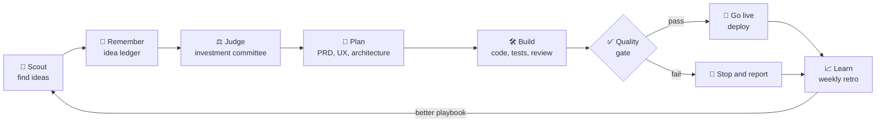

---

## 1. What I did

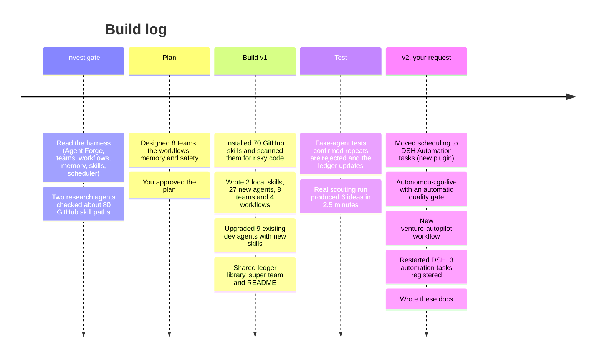

### Files I created or changed

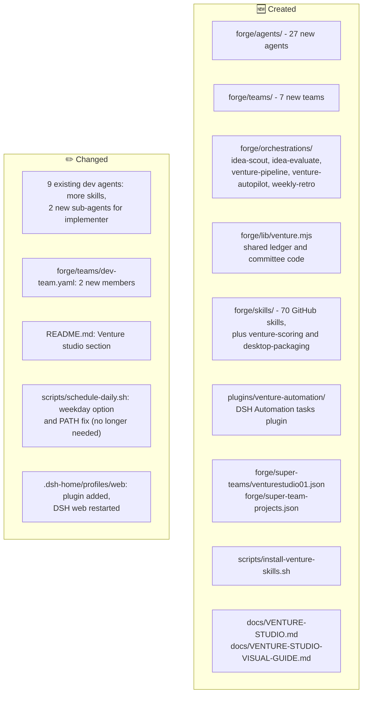

---

## 2. System map: who talks to whom

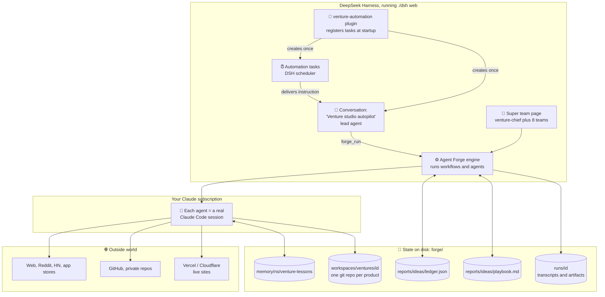

---

## 3. A week on autopilot (Australia/Sydney time)

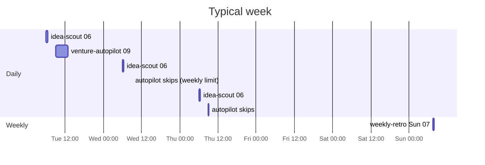

Default: at most **1 new product a week** (`maxPerWeek=1`). On the other days the autopilot checks its limits and exits in seconds.

---

## 4. How an Automation task becomes a workflow run

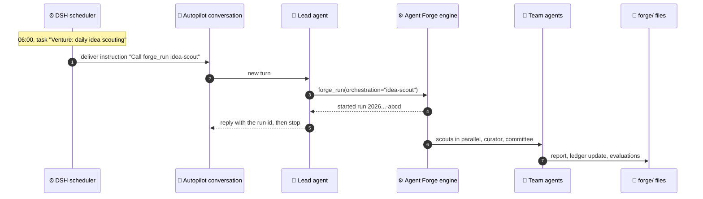

The lead agent only starts the workflow; the workflow runs in the background inside the harness. You can watch it live on the Workflows → **Runs** tab or with `./forge-cli runs`.

---

## 5. `idea-scout`: finding ideas without repeats

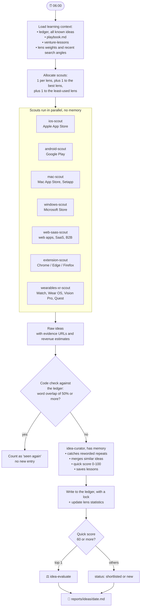

---

## 6. `idea-evaluate`: the investment committee

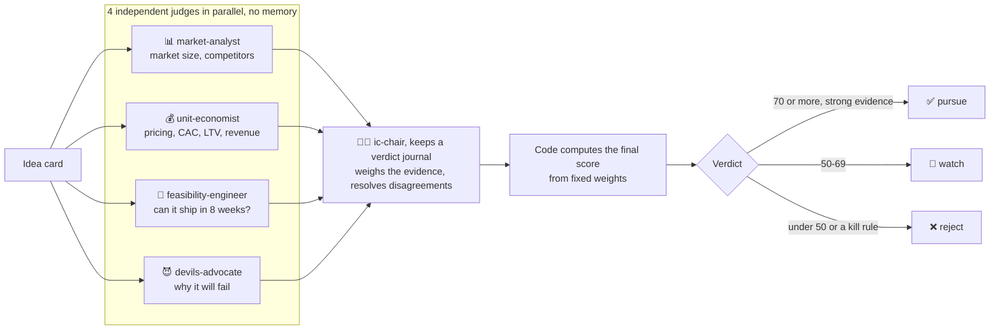

### Scoring weights (out of 100)

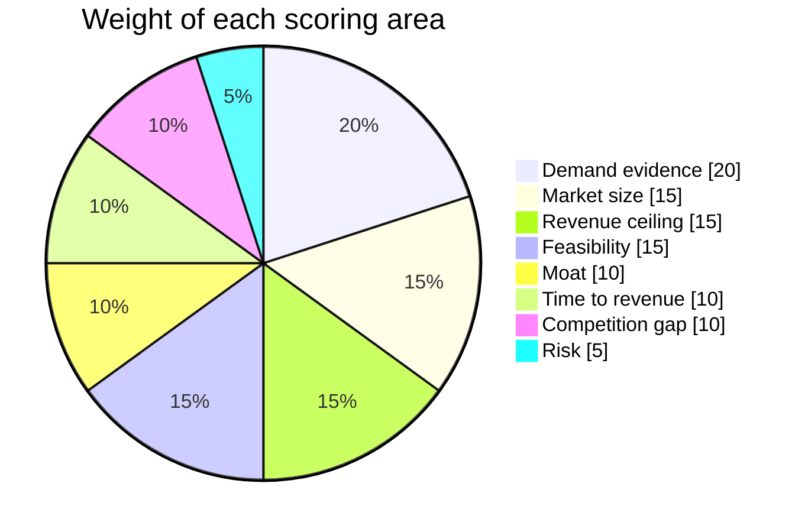

### Revenue tiers (gross revenue per day at maturity)

| Tier | Per day | Meaning |
|---|---|---|
| T0 | under $10k | lifestyle business |
| T1 | $10k-$100k | strong indie business |
| T2 | $100k-$1M | venture scale |
| T3 | $1M-$10M | category leader |
| **T4** | **$10M or more** | **north star, a handful exist** |

---

## 7. `venture-autopilot`: deciding what to build

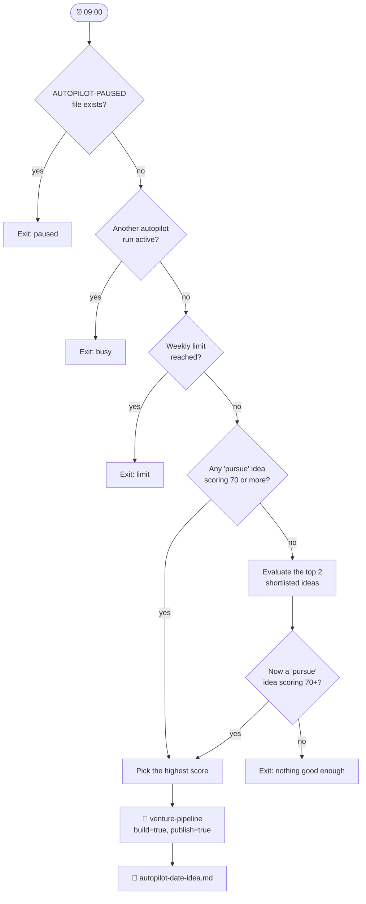

---

## 8. `venture-pipeline`: from idea to a live product

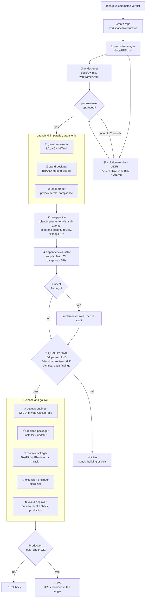

### What ends up in each product repo

```
forge/workspaces/ventures/<idea-id>/
├── docs/
│   ├── IDEA.md            idea card and committee verdict
│   ├── PRD.md             what to build and why
│   ├── UX.md              user flows, screens, design tokens
│   ├── wireframes.html    clickable mock-up of key screens
│   ├── ARCHITECTURE.md    stack and structure
│   ├── PLAN.md            step-by-step build plan
│   └── adr/               architecture decision records
├── launch/
│   ├── LAUNCH-KIT.md      positioning, landing copy, launch plan, SEO, ASO
│   ├── BRAND.md + brand/  names, voice, colors, visuals
│   └── legal/             privacy policy, terms outline, compliance (drafts)
├── src/ ...               the app (built by dev-team)
├── .github/workflows/     CI/CD
├── DEPLOY.md              how it is deployed
└── RELEASE-CHECKLIST.md   secrets and certificates still missing
```

---

## 9. Life of an idea in the ledger

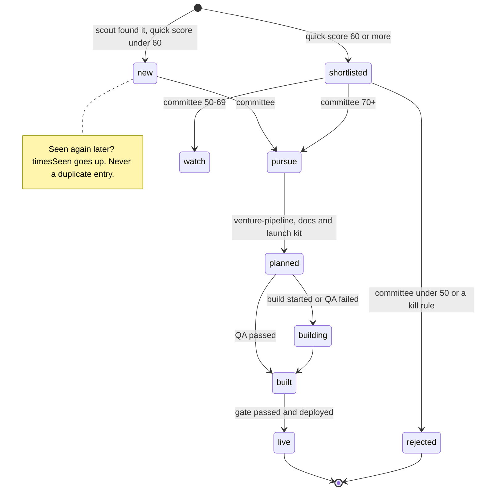

---

## 10. The learning loop

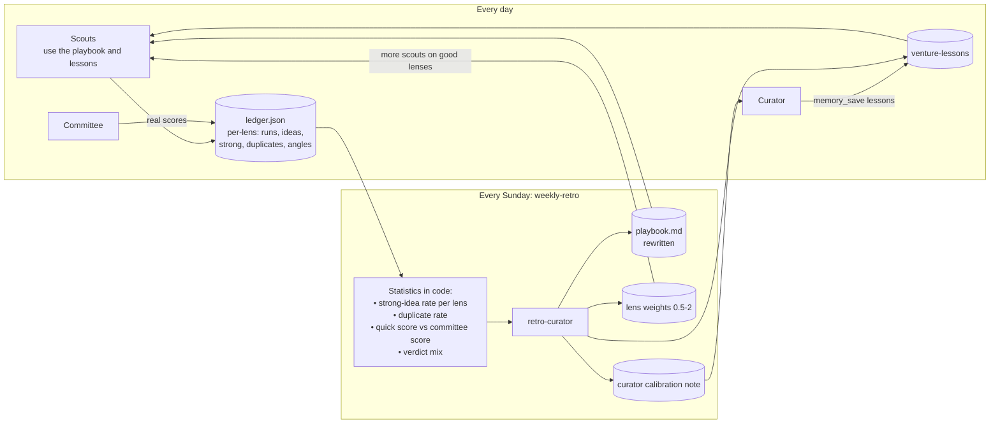

How a scout gets allocated: score = lens weight × (strong ideas + 1) / (all ideas + 2). Extra scouts go to the highest score, and one always explores the least-used lens.

---

## 11. Memory: who remembers what

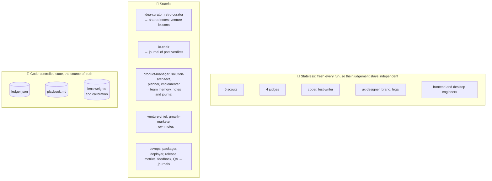

---

## 12. All teams and agents at a glance

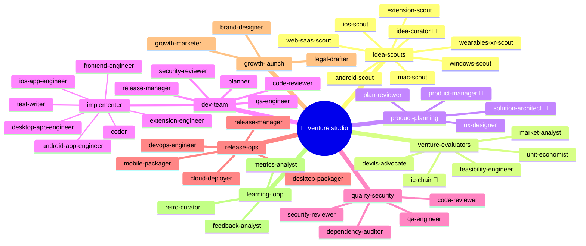

### Main GitHub skills used by each team

| Team | Main skills |
|---|---|
| idea-scouts | last30days, aso-audit, sentiment-analysis, market-sizing, competitor-analysis, venture-scoring |
| venture-evaluators | market-sizing, market-research-reports, financial-analyst, saas-metrics-coach, pricing-strategy, business-model, identify-assumptions-new |
| product-planning | create-prd, write-spec, user-personas, prioritization-frameworks, frontend-design, architecture-decision-records, writing-plans, brainstorming |
| dev-team | test-driven-development, systematic-debugging, executing-plans, subagent-driven-development, verification-before-completion, vercel-react-best-practices, desktop-packaging |
| quality-security | playwright-skill, webapp-testing, e2e-testing-patterns, find-bugs, security-review, differential-review, semgrep, supply-chain-risk-auditor |
| release-ops | github-actions-templates, deployment-pipeline-design, secrets-management, deploy-to-vercel, wrangler, desktop-packaging |
| growth-launch | product-marketing, launch, copywriting, seo-audit, cro, pricing, aso, canvas-design, theme-factory, privacy-policy, compliance-check |
| learning-loop | metrics-review, cohort-analysis, north-star-metric, analytics, analyze-feature-requests, synthesize-research |

---

## 13. Safety rails while running autonomously

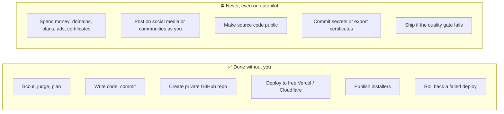

| Control | How |
|---|---|
| Pause autopilot | `touch forge/reports/ideas/AUTOPILOT-PAUSED` (delete the file to resume) |
| Pause any task | **Automation tasks** page → Pause |
| Run a task now | **Automation tasks** page → Run now |
| Change times | **Automation tasks** page → Edit, or `plugins/venture-automation/tasks.json` |
| Build more per week | edit the autopilot task's instruction: `args_json "{\"maxPerWeek\":2}"` |
| See what autopilot would build | `./forge-cli run venture-autopilot dryRun=true` |

---

## 14. Current status: what works and what's needed

| Item | Status |
|---|---|
| All agents, teams, workflows and skills load | ✅ verified |
| Repeat detection, ledger, learning statistics | ✅ fake-agent tests |
| Real scouting run | ✅ 6 ideas in 2.5 minutes |
| Autopilot: pick, build, gate, live (logic) | ✅ fake-agent test |
| Automation tasks registered in DSH | ✅ 06:00, 09:00, Sun 07:30 Sydney |
| First real automatic delivery | ⏳ tomorrow 06:00, or press Run now |
| GitHub login (`gh`) | ✅ logged in |
| **Vercel or Cloudflare login** | ❌ **needed to go live**: run `npx vercel login` or `npx wrangler login` |
| Real end-to-end build and go-live | ⏳ not run yet (heavy subscription usage) |
| macOS code signing | ⚠️ none configured, so installers are unsigned |

---

## 15. Cheat sheet

```bash
cd ~/Documents/deepseekharness/deepseek-teams-harness

./dsh web                                         # start the harness; tasks only fire while it runs
./forge-cli run idea-scout                        # scout now
./forge-cli run idea-evaluate idea=<id>           # committee on one idea
./forge-cli run venture-autopilot dryRun=true     # what would it build?
./forge-cli run venture-pipeline idea=<id>        # plan only
./forge-cli run venture-pipeline idea=<id> build=true publish=true   # build and go live
./forge-cli run weekly-retro                      # learning loop now
./forge-cli runs                                  # recent runs

open forge/reports/ideas/                         # reports, ledger, playbook
```
