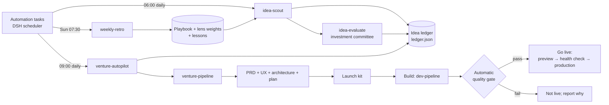

# Venture Studio: what this is and how it was built

_Last updated: 2026-11-09_

## 1. What this project is for

Venture Studio is a team of AI agents, running inside DeepSeek Harness on your Claude subscription, that works like a small startup studio.

1. **Scout.** Every morning it searches the internet for new app, desktop or web business ideas.
2. **Remember.** It writes every idea it has ever seen into a ledger, so it never suggests the same idea twice.
3. **Judge.** An "investment committee" of independent agents scores the best ideas: market size, money, technical difficulty, and reasons it might fail.
4. **Build.** Every day the autopilot takes the best approved idea and builds it. It writes the product spec, the design and the plan, then the code, then tests and security checks.
5. **Go live.** If the automatic quality checks pass, it deploys the product (a website or web app, plus downloadable installers for desktop apps) without asking you.
6. **Learn.** Once a week it reviews which search approaches produced good ideas and how accurate its scores were. It then rewrites its own scouting instructions.

**The goal and the honesty rule.** The north star is an app that could earn **$10M per day** (about $3.65B a year). Only a handful of apps in the world earn that, so every idea gets three honest numbers: realistic revenue per day in year 1, in year 3, and in the best case. The agents are told never to inflate them. A believable $50k per day idea beats an imaginary $10M per day one.

## 2. The big picture



## 3. The teams and agents

There are 8 teams and 36 agents in total, counting the venture-chief supervisor. 27 are new; 9 existing dev agents were reused or upgraded.

| Team | Agents | Job | Memory |
|---|---|---|---|
| **idea-scouts** | ios-scout, android-scout, mac-scout, windows-scout, web-saas-scout, extension-scout, wearables-xr-scout, idea-curator | Seven platform scouts search in parallel, one per target platform or store (iOS App Store, Google Play, macOS, Windows, web/SaaS, browser extensions, wearables/XR). Each one covers store charts, bad reviews, its platform's communities, new platform APIs and revenue data for its platform only. The curator removes duplicates, merges and scores ideas, and records lessons. | Scouts have no memory; the workflow gives them what they need each run. The curator keeps lessons in the shared `venture-lessons` memory. |
| **venture-evaluators** | market-analyst, unit-economist, feasibility-engineer, devils-advocate, ic-chair | Four independent judges work in parallel, then the chair combines their reports into one verdict: pursue, watch or reject. | Judges have no memory, so they stay independent. The chair keeps a journal of past verdicts to stay consistent. |
| **product-planning** | product-manager, ux-designer, solution-architect, plan-reviewer | Writes the PRD, UX spec and wireframes, architecture decisions and implementation plan, then reviews the plan. | Shared team memory |
| **dev-team** | planner, plan-reviewer, implementer (+ coder, test-writer, frontend-engineer, desktop-app-engineer, ios-app-engineer, android-app-engineer, extension-engineer as sub-agents), code-reviewer, security-reviewer, qa-engineer, release-manager | Builds the MVP test-first, reviews the code and runs QA. | Mixed |
| **quality-security** | qa-engineer, code-reviewer, security-reviewer, dependency-auditor | Release quality gate: tests, code review, security and supply-chain audit. | Shared review memory |
| **release-ops** | devops-engineer, desktop-packager, mobile-packager, extension-engineer, cloud-deployer, release-manager | CI/CD, private GitHub repo, desktop installers, App Store / Google Play builds (TestFlight and Play internal testing when credentials exist), extension zips, and deploys to Vercel or Cloudflare. |
| **mobile-apps** | ios-app-engineer, android-app-engineer, mobile-packager, qa-engineer | Platform squad for iPhone/iPad/Apple Watch/Vision Pro and Android/Wear OS. | None |
| **desktop-apps** | desktop-app-engineer, frontend-engineer, desktop-packager, qa-engineer | Platform squad for macOS and Windows. | None |
| **web-apps** | frontend-engineer, extension-engineer, cloud-deployer, qa-engineer | Platform squad for web/SaaS and browser extensions. | None | Release journals |
| **growth-launch** | growth-marketer, brand-designer, legal-drafter | Positioning, landing copy, launch plan, SEO and app-store listing work, brand, and privacy/terms drafts. | The marketer keeps notes |
| **learning-loop** | metrics-analyst, feedback-analyst, retro-curator | Analyzes metrics and feedback, and rewrites the scouting playbook every week. | The retro curator writes `venture-lessons` |

A supervisor agent, **venture-chief**, can run all eleven teams as one "super team". In the web UI it is the **Venture studio** tab on the Super team page; use it when you want to give the studio instructions in plain English.

### Stateful versus stateless agents

- **Stateless agents** (scouts, judges, coders) start fresh every time. This keeps their judgement independent: a judge can't be biased by what it said yesterday.
- **Stateful agents** (curator, chair, retro curator, chief, marketer, planners) keep memory between runs. The harness supports several memory types: notes, a work journal, both together, or full session resume. Each agent uses whichever fits its role.
- **The most important state lives in plain files the code controls**, not in agent memory: the ledger, the playbook and the lens weights. Agents can make mistakes, but a file-based ledger with deduplication done in code cannot "forget" an idea.

## 4. Skills from GitHub

Each agent sees only the skills relevant to its job. 70 skills were installed from GitHub; every path was checked first and the downloads were scanned for risky code. Two more skills were written locally.

| Area | Sources |
|---|---|
| Planning and disciplined coding | `obra/superpowers`: brainstorming, writing-plans, executing-plans, test-driven-development, systematic-debugging, verification-before-completion, code review, git worktrees |
| UI and frontend | `anthropics/skills`: frontend-design, web-artifacts-builder. `vercel-labs/agent-skills`: React best practices, web design guidelines |
| Security | `trailofbits/skills`: semgrep, sharp-edges, supply-chain-risk-auditor, differential-review, property-based-testing. `getsentry/skills`: security-review, gha-security-review, find-bugs |
| Testing | `lackeyjb/playwright-skill`, `wshobson/agents` e2e-testing-patterns, Anthropic's webapp-testing |
| DevOps and deploy | `wshobson/agents`: GitHub Actions, deployment pipelines, secrets management. Official `deploy-to-vercel`, Cloudflare `wrangler` and `workers-best-practices` |
| Market research | `mvanhorn/last30days` (Reddit, HN, X, YouTube signals), `phuryn/pm-skills` (market sizing, competitors, personas, sentiment), K-Dense market-research-reports |
| Product and business | `phuryn/pm-skills`: PRD, strategy, prioritization, business model, lean canvas, pricing, assumptions. `alirezarezvani/claude-skills`: financial-analyst, SaaS metrics. Anthropic knowledge-work: write-spec, metrics-review |
| Growth | `coreyhaines31/marketingskills`: launch, copywriting, SEO audit, conversion (CRO), pricing page, app-store optimization (ASO), analytics. `appeeky/aso-skills` |
| Brand and legal | `anthropics/skills`: canvas-design, theme-factory. `phuryn` privacy-policy, Anthropic compliance-check |
| Written locally | `venture-scoring`: the shared scoring rubric, revenue tiers and kill rules. `desktop-packaging`: Tauri/Electron packaging, signing, auto-update and release CI; nothing good existed on GitHub. |

Reinstall or refresh all skills with `scripts/install-venture-skills.sh` (add `--overwrite` to refresh). Skipped on purpose:
- `deanpeters` product skills: the license allows non-commercial use only.
- trailofbits `insecure-defaults`: it does not exist in that repo.

## 5. How each workflow works

### 5.1 `idea-scout` (daily)
1. **Plan the scouts.** One scout per platform lens (`ios`, `android`, `macos`, `windows`, `web`, `extensions`, `wearables-xr`), plus 2 extra scouts:
   - one goes to the lens with the best record so far: its share of strong ideas, multiplied by the weight the weekly review gave that lens;
   - one explores the lens that has been used least.
2. **Brief them.** Each scout receives:
   - the playbook and lessons learned;
   - the ideas already in the ledger (so it doesn't resubmit them);
   - its lens's recently used search angles (so it rotates to new ones).
3. **Scout in parallel.** Each returns ideas with evidence URLs, keywords and three revenue numbers.
4. **Remove duplicates in code.** Each idea is compared against the ledger by word overlap between titles and keywords. Clear repeats are dropped and counted as "seen again".
5. **Curator.** Catches repeats worded differently, merges near-identical ideas and gives each a quick score from 0 to 100.
6. **Record.** New ideas go into the ledger and each lens's statistics are updated. The ledger has a lock, so two runs can't corrupt it.
7. **Evaluate.** The best new ideas go to the committee (by default the top 1 with a quick score of 60 or more).
8. **Report.** Written to `forge/reports/ideas/<date>.md`.

### 5.2 `idea-evaluate` (the investment committee)
1. **Four judges in parallel**, each scoring the same 8 areas with evidence:
   - the **market analyst** sizes the market;
   - the **unit economist** models pricing and profit;
   - the **feasibility engineer** decides if it can be built in 8 weeks;
   - the **devil's advocate** tries to kill the idea.
2. **The chair** combines their reports into one verdict and explains any disagreements.
3. **Code computes the final score** from fixed weights, so the rubric can't drift.
4. **Saved** to `forge/reports/ideas/evaluations/<id>.md` and the ledger.

### 5.3 `venture-pipeline` (idea → live product)
1. **Repo.** Creates a product repo at `forge/workspaces/ventures/<id>/`.
2. **Spec.** PRD, then UX and architecture in parallel, then up to 2 rounds of plan review.
3. **Launch kit.** Marketing, brand and legal drafts in `launch/`.
4. **Build** (with `build=true`). Runs the existing `dev-pipeline`: implement with sub-agents, code and security review with fix rounds, then QA.
5. **Audit.** Dependency and supply-chain audit, with one automatic fix round for critical findings.
6. **Automatic quality gate.** Passes only if all of these hold:
   - QA passed;
   - zero blocking review findings;
   - zero critical audit findings.
7. **Go live** (with `publish=true` and a passed gate):
   - CI is set up and a **private** GitHub repo is created;
   - installers are built for desktop apps;
   - **preview deploy → health check → production deploy → health check**, rolling back automatically on failure.
8. **Record.** Live URLs are saved to the ledger (status `live`).

### 5.4 `venture-autopilot` (daily, autonomous)
1. **Should it run at all?** It does nothing if:
   - it is paused (`forge/reports/ideas/AUTOPILOT-PAUSED` exists);
   - another autopilot run is active (lock file);
   - this week's limit is reached (default 1 venture per 7 days).
2. **Pick.** Takes the highest-scoring idea with a "pursue" verdict scoring at least 70. If none is waiting, it first evaluates the top 2 shortlisted ideas.
3. **Build and ship.** Runs `venture-pipeline` with `build=true publish=true`, so no human is needed.
4. **Report.** Written to `forge/reports/ideas/autopilot-<date>-<idea>.md`.

### 5.5 `weekly-retro` (Sundays)
1. **Statistics in code:**
   - share of strong ideas per lens;
   - duplicate rate;
   - how far quick scores were from committee scores (calibration);
   - verdict mix and top ideas.
2. **Outcomes.** Optional metrics and feedback analysis for launched products.
3. **The retro curator** rewrites `playbook.md` (old versions go to `playbook-history/`). It also sets lens weights between 0.5 and 2, and writes a calibration note for the curator.
4. **Next week** uses all of this automatically: that is the self-learning loop.

## 6. Automation: how it runs on a schedule

The schedule uses **DeepSeek Harness's own Automation tasks**, not a macOS cron job.

- **The plugin.** `plugins/venture-automation` is a small harness plugin. When `./dsh web` starts, it:
  1. creates (once) a conversation called **Venture studio autopilot**;
  2. registers the tasks from `plugins/venture-automation/tasks.json` with the harness scheduler. Each task is registered exactly once; a task you delete is never re-created.
- **When a task fires**, the harness delivers its instruction to that conversation. The lead agent calls `forge_run`, and the workflow runs inside the harness.
- **Manage the tasks** from the sidebar's **Automation tasks** page: pause, resume, edit the time, Run now, delete.

| Task | Time (Australia/Sydney) | Workflow |
|---|---|---|
| Venture: daily idea scouting | 06:00 daily | idea-scout |
| Venture: autopilot (build and go live) | 09:00 daily | venture-autopilot |
| Venture: weekly retrospective | Sundays 07:30 | weekly-retro |

The harness (`./dsh web`) must be running for tasks to fire. After a restart it sends only the most recent missed run.

## 7. Autonomy and the rules that still apply

You asked for the studio to go live without you, so there is no human approval step any more. The automatic quality gate takes its place. A few hard rules remain, because breaking them could cost you money or reputation without you knowing:

- **No spending.** Free tiers only: no buying domains, upgrading plans, paid certificates, store accounts or ads.
- **No posting as you.** Agents never post to social networks or communities in your name; launch posts are prepared as drafts in `launch/`.
- **Private source code.** GitHub repos are created private.
- **No secrets in git.** Secrets are never committed and certificates are never exported.
- **Rollback.** A production deploy that fails its health check is rolled back.
- **Volume and quality limits.** At most 1 new venture per week, and only ideas the committee scored at least 70.

**To go live, the deploy accounts must already be logged in on this Mac:**
- GitHub (`gh`): logged in.
- Vercel or Cloudflare: **not set up yet**. Run `npx vercel login` or `npx wrangler login` once.

Until then the autopilot builds everything and reports `blockedBy: not logged in` instead of deploying.

**Pause or stop:**
- `touch forge/reports/ideas/AUTOPILOT-PAUSED` pauses the autopilot; delete the file to resume.
- Or pause the tasks on the Automation tasks page.

## 8. Day-to-day commands

```bash
./dsh web                                              # start the harness (tasks only fire while it runs)
./forge-cli run idea-scout                             # scout now
./forge-cli run idea-scout focus="tools for video creators"
./forge-cli run idea-evaluate idea=<ledger id or text> # full committee review
./forge-cli run venture-autopilot dryRun=true          # see what autopilot would build
./forge-cli run venture-pipeline idea=<id>             # plan only (spec, design, launch kit)
./forge-cli run venture-pipeline idea=<id> build=true publish=true
./forge-cli run weekly-retro
./forge-cli runs                                       # recent runs; details in forge/runs/<id>/
```

## 9. Where things live

| Path | What |
|---|---|
| `forge/agents/*.yaml` | Agent definitions: model, tools, skills, memory and role |
| `forge/teams/*.yaml` | Team definitions |
| `forge/orchestrations/` | Workflows: `idea-scout.js`, `idea-evaluate.js`, `venture-pipeline.js`, `venture-autopilot.js`, `weekly-retro.js` |
| `forge/lib/venture.mjs` | Shared code: ledger with lock, duplicate check, scout allocation, schemas, committee |
| `forge/skills/` | Installed skills plus the local `venture-scoring` and `desktop-packaging` |
| `forge/reports/ideas/` | `ledger.json`, `playbook.md`, daily reports, evaluations, retros, autopilot reports |
| `forge/memory/` | Agent memory, including the shared `venture-lessons` namespace |
| `forge/workspaces/ventures/<id>/` | Each product's git repo: `docs/`, `launch/` and source code |
| `forge/runs/<id>/` | Every run: status, per-agent transcripts, artifacts |
| `forge/super-teams/venturestudio01.json` | The Venture studio super team |
| `plugins/venture-automation/` | The harness plugin that registers the Automation tasks |
| `scripts/install-venture-skills.sh` | Reinstalls all GitHub skills |

## 10. How it was verified

- **All definitions load:** 47 agents, 10 teams, 9 workflows and every referenced skill.
- **Scouting with fake agents:** run twice. The second run correctly rejected all 6 repeated ideas; lens statistics, ledger, reports and evaluation files were all written.
- **Autopilot with fake agents:** end to end.
  - First run: evaluate, pick, plan, build, quality gate, then marked live.
  - Second run: skipped because of the weekly limit.
  - Third run: skipped because of the lock.
- **Real scouting run** (2 scouts plus the curator, about 2.5 minutes): 6 genuine ideas with sources and honest scores. The highest score was 60/100 and the highest ceiling was about $1M per day.
- **Automation tasks:** registered in the harness scheduler with the times above. Their first real delivery will be at 06:00. To test now, press **Run now** on the Automation tasks page.
- **Not yet tested for real:** a full real build and go-live. It needs a Vercel or Cloudflare login, and it uses a lot of subscription usage.

## 11. Costs and limits

- **Subscription usage.** Every agent is a real Claude Code session on your Claude plan, so runs count against its usage limits. Rough usage per run:
  - daily scouting: about 7 agents, plus 5 for one committee review;
  - one autopilot build: dozens of agent runs.
  - `FORGE_MAX_PARALLEL` (default 4) limits how many agents run at once.
- **Quality isn't guaranteed.** AI agents can be wrong. The quality gate checks tests, reviews and audits, not whether the business will succeed. Read the evaluation reports before you put real money or your name behind a product.
- **Signing.** Desktop installers are unsigned unless Apple or Windows signing identities are already configured. Unsigned macOS apps show a Gatekeeper warning.
- **Legal drafts.** Privacy policy and terms are drafts marked for lawyer review.
